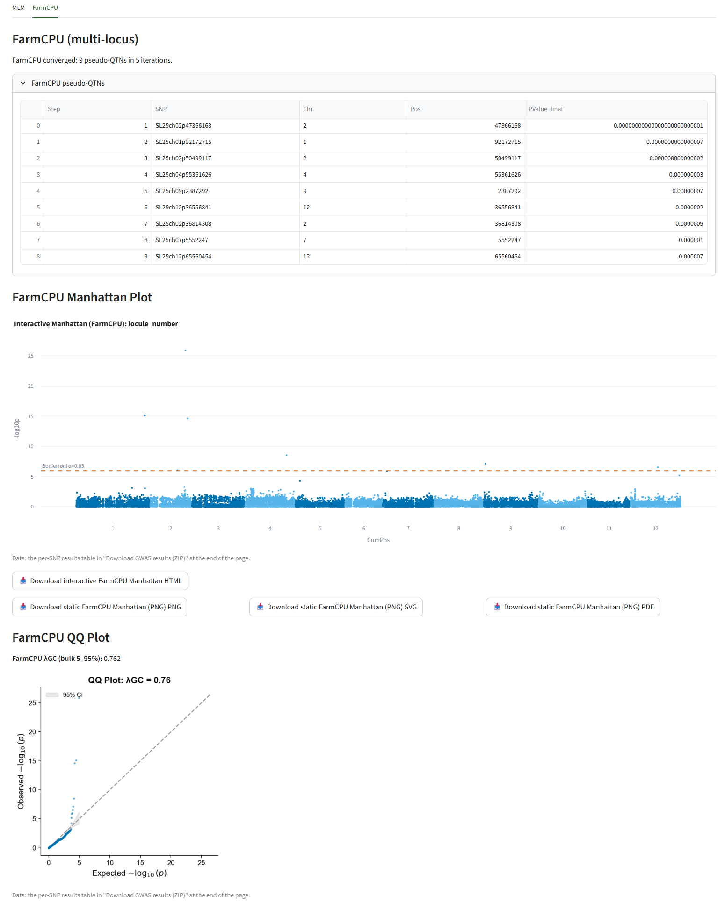
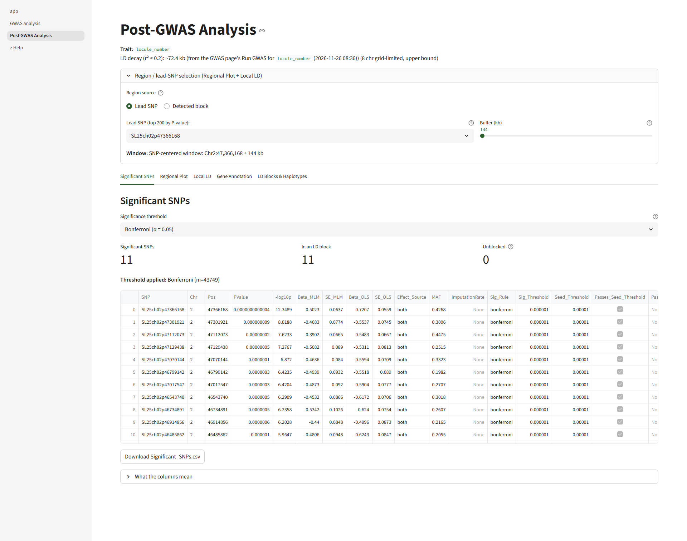
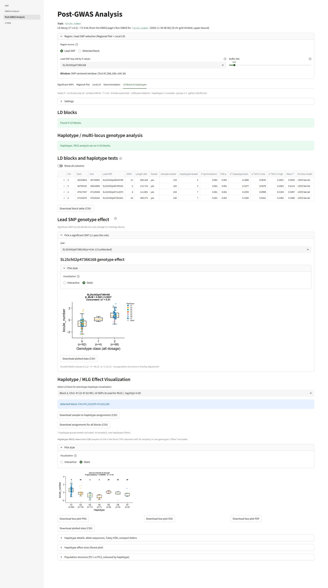
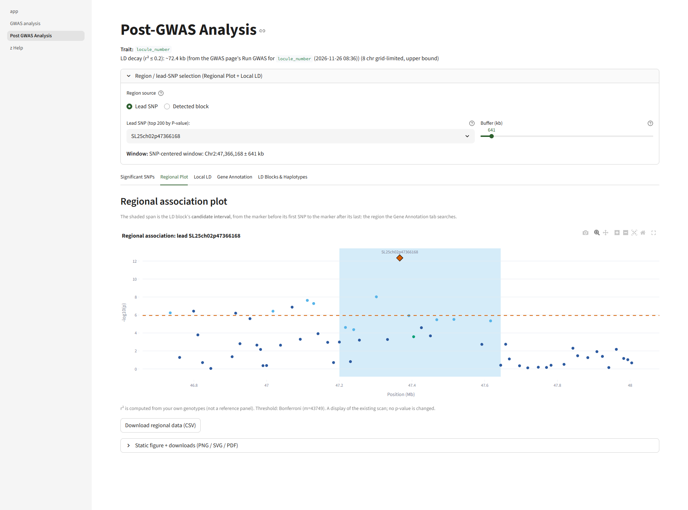
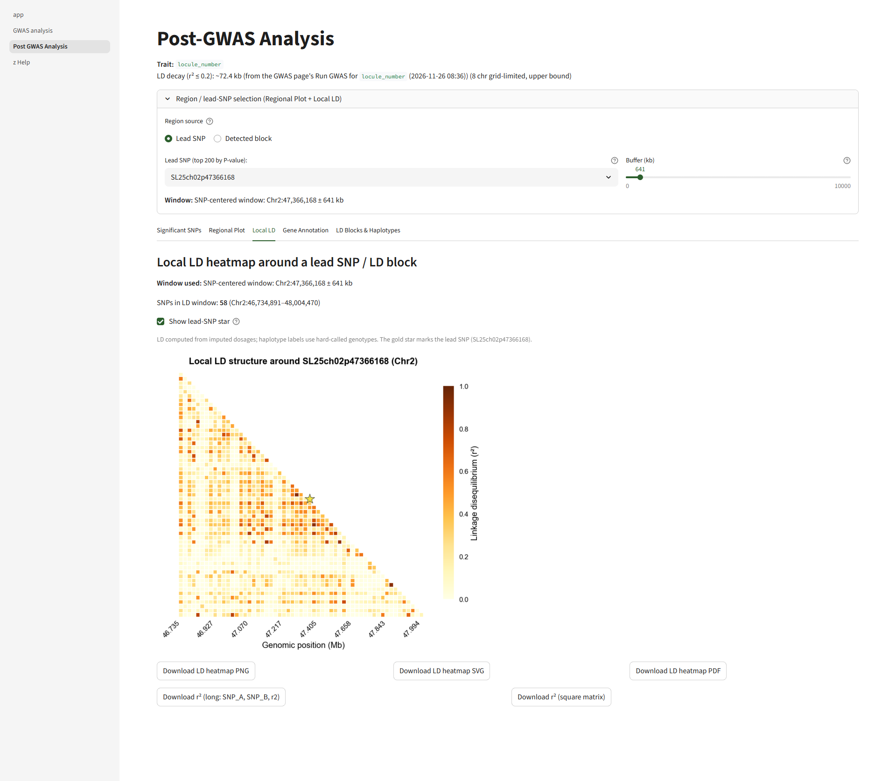
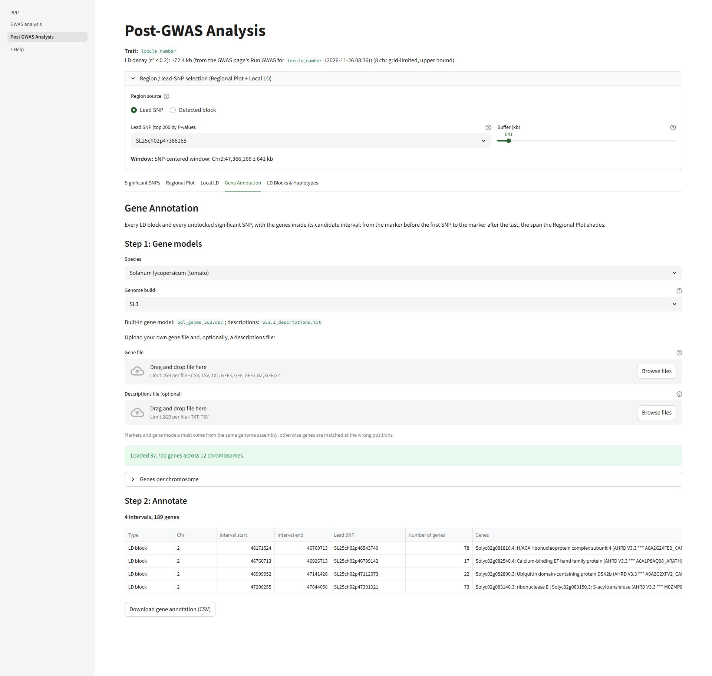

# TRACE: An Automated, Extensive GWAS Framework for Crop Breeding

TRACE takes a VCF and a phenotype table and goes from the association scan to a short list of
candidate genes. In one command, or one click in its GUI, it runs quality control, a GWAS with
LOCO kinship, LD blocks, haplotype tests and gene annotation, and on request subsampling
stability. It was built around tomato diversity panels and works with any diploid VCF.

> Developed at the [Center of Plant Systems Biology and Biotechnology (CPSBB)](https://cpsbb.eu/), Plovdiv,
> Bulgaria, as part of the **NATGENCROP** project (EU Horizon Europe).

[](https://doi.org/10.5281/zenodo.19678860)
[](https://opensource.org/licenses/MIT)
[](https://www.python.org/downloads/)

## Getting started

With Docker, the GUI needs no other install:

```bash
docker pull ghcr.io/ioannisperachoritis-hub/trace:latest
docker run -p 8501:8501 ghcr.io/ioannisperachoritis-hub/trace:latest
```

The pull gets the newest version. Without it, Docker reuses a copy it downloaded before. To reproduce the paper, use the tag `1.2.0` in place of `latest`. On a Mac with an Apple chip, add `--platform linux/amd64` to both commands.

Then open <http://localhost:8501>. Without Docker, install TRACE with
[uv](https://docs.astral.sh/uv/) or with pip (Python 3.11 to 3.13):

```bash
git clone https://github.com/IoannisPerachoritis-hub/TRACE.git && cd TRACE
pip install -e .        # or: uv venv --python 3.11, activate it, then uv pip install -e .
```

If pip stops because of your Python version (for example Python 3.14), use the uv line instead.
uv downloads Python 3.11 by itself if your computer does not have it.

Try the bundled example (100 lines, 600 SNPs, a QTL on chromosome 2). In the GUI, start it,
upload `examples/example.vcf.gz` and `examples/example_pheno.csv`, pick `Trait1` and run
One-Click Full Analysis:

```bash
streamlit run app.py
```

From the command line, in one command:

```bash
trace-gwas --vcf examples/example.vcf.gz --pheno examples/example_pheno.csv --trait Trait1 --output results/
```

[Installation](docs/installation.md#docker-nothing-else-to-install) has the details, with the
Docker command for the CLI: it mounts your folder at `/data` and runs as your own user.

## What TRACE does

- Quality control of SNPs and samples, with a QC report.
- GWAS with three models: MLM with LOCO kinship (FaST-LMM), MLMM and TRACE-FarmCPU, with
  covariates and a fixed number of PCs. The significance threshold is Bonferroni by default, or
  M_eff, FDR or a p-value of your choice.
- LD blocks around the significant SNPs, and haplotype tests that account for kinship.
- Regional plots and LD heatmaps from the analysed genotypes.
- Gene annotation with the bundled tomato gene models, or your own for any species.
- Subsampling stability: how often each SNP is found when part of the panel is left out.
- Large datasets: the genotype table can stay on disk, with the same results.
- One results ZIP per trait, with the tables, the figures and an HTML report. The GUI and the CLI
  give the same results.

## From GWAS hits to candidate genes

1. **Find SNPs that more than one model detects.** Run MLM with MLMM and FarmCPU. On the GWAS
   Analysis page, the Cross-model comparison lists each significant SNP with the models that
   detect it. A SNP just below the line (around p = 1e-4) that other models also pick up is worth
   a look, as a lead to check, not a finding. [Tutorial](docs/tutorial.md#1-find-snps-that-more-than-one-model-detects)
2. **Look at the region.** On the Post-GWAS Analysis page, the Regional Plot and the Local LD tabs
   show the signal and how far LD extends around it.
   [Tutorial](docs/tutorial.md#2-look-at-the-region)
3. **Check the effect.** On the LD Blocks & Haplotypes tab, use the haplotype test for a SNP
   inside an LD block, or the box plot under Lead SNP genotype effect for a single SNP. Check that
   each group is big enough and that no outliers drive the p-value.
   [Tutorial](docs/tutorial.md#3-check-the-effect)
4. **Go to the candidate genes.** The Gene Annotation tab takes the region from each LD block and
   lists the genes in it. Fewer genes, with a clean split between groups, make a stronger
   candidate. [Tutorial](docs/tutorial.md#4-go-to-the-candidate-genes)

## Input files

### Genotypes

A VCF, plain or compressed. TRACE does not read PLINK, CSV or Zarr genotype files. Convert PLINK
files with the PLINK 2 command in [Input files](docs/input_files.md#plink-csv-and-zarr-files).

### Phenotypes

A CSV or TSV file with the sample IDs in the first column and one numeric column per trait.
[Input files](docs/input_files.md#phenotypes-a-table) gives the details, with covariates and gene
models.

## Documentation

- [Tutorial](docs/tutorial.md): the bundled example in the GUI and the CLI, and the four steps above.
- [Installation](docs/installation.md): Docker, uv and pip, and the main dependencies.
- [Input files](docs/input_files.md): the VCF, the phenotype table, covariates, gene models, and
  PLINK files converted to VCF.
- [Outputs](docs/outputs.md): the files of the results ZIP and of the Post-GWAS tabs.
- [CLI options](docs/cli_reference.md): every option of `trace-gwas`.
- [The GUI and the CLI](docs/gui_and_cli.md): where each analysis is in each.
- [Large datasets](docs/large_datasets.md): the genotype table on disk, memory and run times.
- [Troubleshooting](docs/troubleshooting.md): memory, big files, Docker folders, a Run that stops
  part way.
- [Gene model upload](docs/gene_model_upload.md): the format of your own gene model.
- [Development](docs/development.md): the repository layout and the tests.
- [Benchmarks](benchmarks/README.md): the scripts and data behind the paper's tables and figures.

## Citation

If you use TRACE in your research, please cite:

> To be filled after acceptance.
>
> Software archive: [10.5281/zenodo.19678860](https://doi.org/10.5281/zenodo.19678860), concept DOI,
> resolving to the latest archived version. Each release also carries its own version DOI.
>
> See [CITATION.cff](CITATION.cff) for citation metadata.

## License

MIT. See [LICENSE](LICENSE).

## Acknowledgments

- **European Regional Development Fund**: Program "Research Innovation and Digitalisation for Smart
  Transformation" 2021-2027, Grant No. BG16RFPR002-1.014-0003-C01
- **NATGENCROP Project**: HORIZON-WIDERA-2022-TALENTS-01, No. 101087091
- **Center of Plant Systems Biology and Biotechnology (CPSBB)**, Plovdiv, Bulgaria

<details>
<summary>Screenshots</summary>

**GWAS Analysis**: the data checks (QC, relatedness, trait distribution) and the MLM scan with its
Manhattan and QQ plots.


**TRACE-FarmCPU**: the multi-locus scan with pseudo-QTNs chosen by REML and a fixed-effect final
test.



**Significant SNPs**: every significant SNP with its effect sizes, and whether it lies in an LD
block.



**Post-GWAS Analysis**: LD blocks around the significant SNPs, haplotype tests (Tukey HSD with
compact letters, raincloud and forest plots) and a PCA coloured by haplotype.



**Regional plot**: position against the association statistic, coloured by r² to the lead marker
from the analysed genotypes, with the candidate interval shaded. The static figure adds a gene
track.



**Local LD heatmap**: the heatmap around a lead SNP. Pick a detected block in the region selector
to see the block with its neighbouring SNPs.



**Gene annotation**: the genes in each candidate interval, from the bundled tomato gene model or
your own gene file.



</details>
