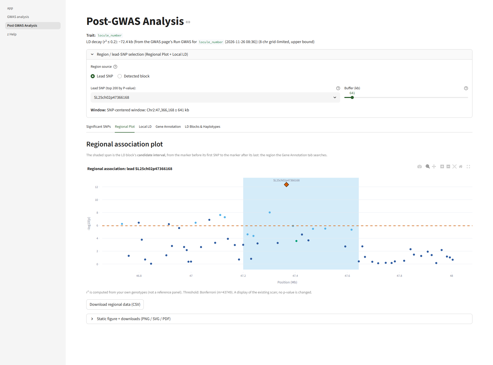
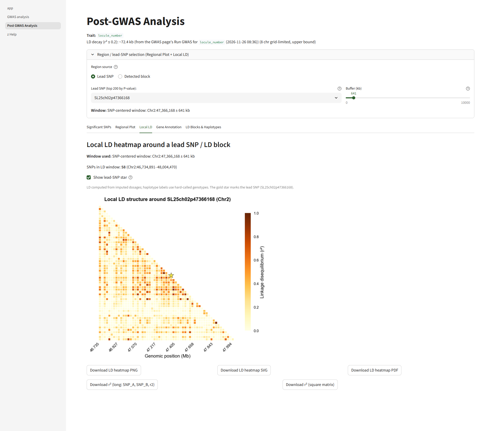
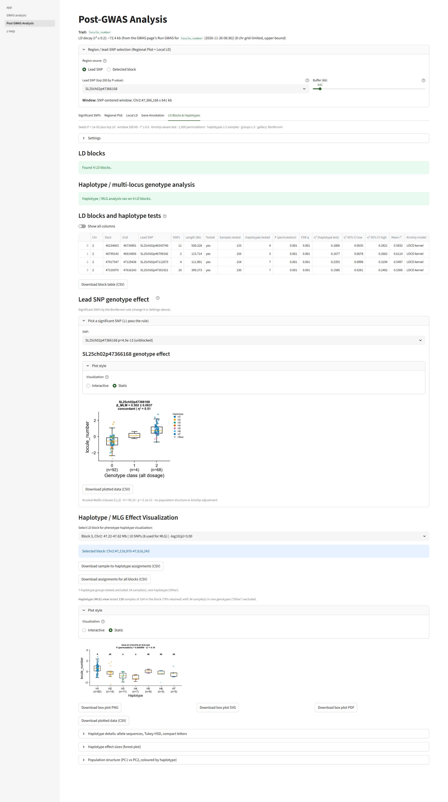

# TRACE tutorial

This tutorial runs TRACE on the small example that comes with it, first from the command line and
then in the GUI. It ends with the four steps from GWAS hits to candidate genes, on the same
example. It takes a few minutes.

## The example

The example is in the repository:

- `examples/example.vcf.gz`: 100 inbred lines and 600 SNPs on 3 chromosomes. The lines are
  mosaics of four founder haplotypes, so neighbouring SNPs are in linkage disequilibrium (LD) and
  LD decays with distance.
- `examples/example_pheno.csv`: two traits. `Trait1` has one QTL, `chr02_1010000` (h² about 0.3),
  inside an LD block on chromosome 2. `Trait2` is noise.

`examples/simulate_example.py` makes the same files again (seed 42), so a fresh clone gives
identical files. A run with MLM takes about 8 seconds, and about 12 with all three models.

## Part A: the command line

### 1. One command

```bash
bash examples/run_example.sh
```

The script writes the example files with `simulate_example.py`, then runs TRACE's MLM on `Trait1`
and writes a results ZIP to `examples/output/`.

### 2. Your own options

Call the CLI yourself to try other models or options:

```bash
trace-gwas \
  --vcf   examples/example.vcf.gz \
  --pheno examples/example_pheno.csv \
  --trait Trait1 \
  --output examples/output/ \
  --model mlm
```

**What you see.** At the defaults (MLM, Bonferroni), the significant SNPs of `Trait1` all lie on
chromosome 2 within 60 kb of the QTL. TRACE finds one LD block there (960,000 to 1,070,000 bp),
tests its haplotypes (`Hap_PValue` in `tables/LD_blocks_annotated_MLM.csv`) and draws its LD
heatmap (`figures/LD_heatmap_Chr2_960000_1070000.png`). `Trait2` has no significant SNP.

Without the installed package (`pip install -e .`), use `python cli.py` in place of
`trace-gwas`. `trace-gwas --help` and the [CLI reference](cli_reference.md) list every option.

### Main options

| Option | What it sets | Default |
|---|---|---|
| `--vcf` | the VCF, plain or compressed | required |
| `--pheno` | the phenotype table (sample IDs, then traits) | required |
| `--trait` | the trait or traits, run one after another | required |
| `--output` | the folder for the results | required |
| `--model` | the models (`mlm`, `mlmm`, `farmcpu`) | `mlm` |
| `--n-pcs` | the number of PCs (a fixed count, with diagnostics in the report) | 0 |
| `--maf` | the lowest minor allele frequency | 0.05 |
| `--miss` | the highest missing rate per SNP | 0.10 |
| `--sig-thresh` | the significance rule: `bonferroni`, `meff`, `fdr` or a p-value such as `5e-8` | `bonferroni` |
| `--seed` | the seed of the subsampling (haplotype permutations are seeded per block from its position and the trait) | 42 |
| `--subsampling` | the subsampling stability analysis | off |
| `--export-qc` | the QC data for other tools | off |
| `--no-plots` | skip the plots | off |
| `--no-annotation` | skip the gene annotation | off |

### The results ZIP

- `tables/GWAS_<trait>.csv`: the full GWAS table.
- `tables/CrossModel_Consensus.csv`: each significant SNP with the models that detect it (with two
  or more models).
- `tables/LD_blocks_annotated_<model>.csv`: the LD blocks, with their genes and haplotype tests.
- `figures/`: Manhattan and QQ plots, LD heatmaps.
- `report.html`: one HTML report of the run.

The Help & Reference page of the GUI explains every column. [Outputs](outputs.md) describes the
files that the Post-GWAS tabs write.

## Part B: the GUI

The GUI runs the same analysis as the CLI. Start it:

```bash
streamlit run app.py
```

The browser opens TRACE's start page. The sidebar lists the pages, which you visit in this order.

### Step 1: GWAS Analysis

Open **GWAS Analysis** ("TRACE GWAS").

1. Upload the VCF (`examples/example.vcf.gz`) and the phenotype file
   (`examples/example_pheno.csv`).
2. Keep the QC settings (MAF, missing rates, INFO) and the imputation, or change them. Set the
   number of PCs (a fixed count: TRACE does not pick one for you).
3. Pick the trait `Trait1`.
4. Run. For the whole analysis, open **One-Click Full Analysis** and click **Run Full Analysis**.
   It runs MLM, the other models, the LD blocks, the haplotype tests, the gene annotation and the
   report. **Run GWAS** runs the detailed view of one trait instead.

When the run ends, the page shows the Manhattan and QQ plots, λGC and the table of significant
SNPs, with a button for the results ZIP: the same ZIP as the CLI's.


*The screenshots show the tomato data, not the example.*

**Covariates from the phenotype file.** Under the phenotype file, "Use columns of
this file as covariates" adds the columns you choose to the models as covariates,
for example a correlated trait for a conditional GWAS. TRACE uses their values as
uploaded, never a transformed trait, and the chosen columns leave the trait list.
Use one source at a time: a covariate file or these columns. The CLI does the same
with `--covar pheno.csv --covar-cols weight_g`. Adjusting for a correlated,
heritable trait can create or hide associations at loci that affect that trait
(Aschard et al. 2015); compare with the unadjusted run.

### Step 2: Post-GWAS Analysis

Open **Post-GWAS Analysis**. It uses the GWAS run of step 1, so run that first. Pick a region or a
lead SNP in the selector at the top, then use the tabs:

- **Significant SNPs**: the whole table of significant SNPs, each marked in a block or unblocked.
- **Regional Plot**: −log₁₀(p) against position, coloured by r² with the lead SNP, with a gene
  track.
- **Local LD**: the r² heatmap of the window. For a detected block, the block with its
  neighbouring SNPs.
- **Gene Annotation**: each LD block and each unblocked significant SNP, with the genes in its
  candidate interval (from the marker before its first SNP to the marker after its last).
- **LD Blocks & Haplotypes**: the blocks, their haplotype tests and the haplotype groups. Its
  Settings show the LD decay of the GWAS run and the block window it sets: four times the
  decay, or 300 kb when the decay cannot be estimated. The Regional Plot keeps twice the decay.

### Step 3: Help & Reference

**Help & Reference** explains the output files and their columns, and how to read the results.

## From GWAS hits to candidate genes

The four steps below take a hit to a short list of genes. On the example they take a few minutes.
The values given are those of the example with all three models at the default settings (the
CLI's `--model mlm mlmm farmcpu`).

### 1. Find SNPs that more than one model detects

In the GWAS Analysis page's sidebar, under "Additional GWAS models", add MLMM to FarmCPU, then
click **Run GWAS**. The section **Cross-model comparison** has the table "Cross-model consensus":
each significant SNP with the models that detect it (`CrossModel_Consensus.csv` in the ZIP).

On the example, 12 SNPs on chromosome 2 are significant in at least one model. Two are found by
two models: `chr02_1020000` (MLM and FarmCPU) and `chr02_980000` (MLM and MLMM). The QTL,
`chr02_1010000`, lies between them and is found by MLM. A SNP just below the line (around p =
1e-4) that other models also pick up is worth a look, as a lead to check, not a finding.

### 2. Look at the region

Open **Post-GWAS Analysis** and choose the lead SNP in the selector at the top. The **Regional
Plot** shows the signal along the chromosome, each SNP coloured by its r² with the lead SNP. The
**Local LD** tab shows how far LD extends. Set the selector to "Detected block" to see the block
with its neighbouring SNPs. On the example, the block runs from 960,000 to 1,070,000 bp and holds
all 12 significant SNPs.





### 3. Check the effect

Open **LD Blocks & Haplotypes**. For a SNP inside an LD block, the haplotype test compares the
phenotype between the block's haplotype groups, with Tukey letters, a box plot and a forest plot.
For a single SNP, the box plot under "Lead SNP genotype effect" shows the phenotype per genotype.
Check that each group is big enough and that no outliers drive the p-value.

On the example, the block's samples form two tested haplotype groups, of 67 and 21 lines. The 12
lines in rare haplotypes are left out of the test. The test's p-value is at its floor for 1,000
permutations (0.001), and the groups explain 27% of the variance (η² 0.27).



### 4. Go to the candidate genes

Open **Gene Annotation**. It takes the region of each LD block, from the marker before its first
SNP to the marker after its last, and lists the genes in it. Fewer genes, with a clean split
between groups, make a stronger candidate.

On the example, the region is 950,000 to 1,080,000 bp on chromosome 2. Its positions are
simulated, so the bundled tomato gene model has no gene there. With your own data and gene model,
the genes of the region appear in this table.

## Real datasets

TRACE was tested on:

1. **The tomato Varitome panel**: 165 accessions, about 44,000 SNPs (Pereira et al., 2021).
2. **The pepper G2P-SOL panel**: 350 accessions, about 5,000 SNPs (Tripodi et al., 2021).
3. **The rice 3K-RG panel**: 2,260 accessions, about 186,000 SNPs (Wang et al., 2018).

## Docker

```bash
docker build -t trace .
docker run -p 8501:8501 trace
```

The GUI reads your files through the browser upload, so it needs no mount. Do not mount a folder
over `/app` or `/app/data`: that hides TRACE or its bundled gene models. For the CLI in Docker, see
[Installation](installation.md#docker-nothing-else-to-install).
